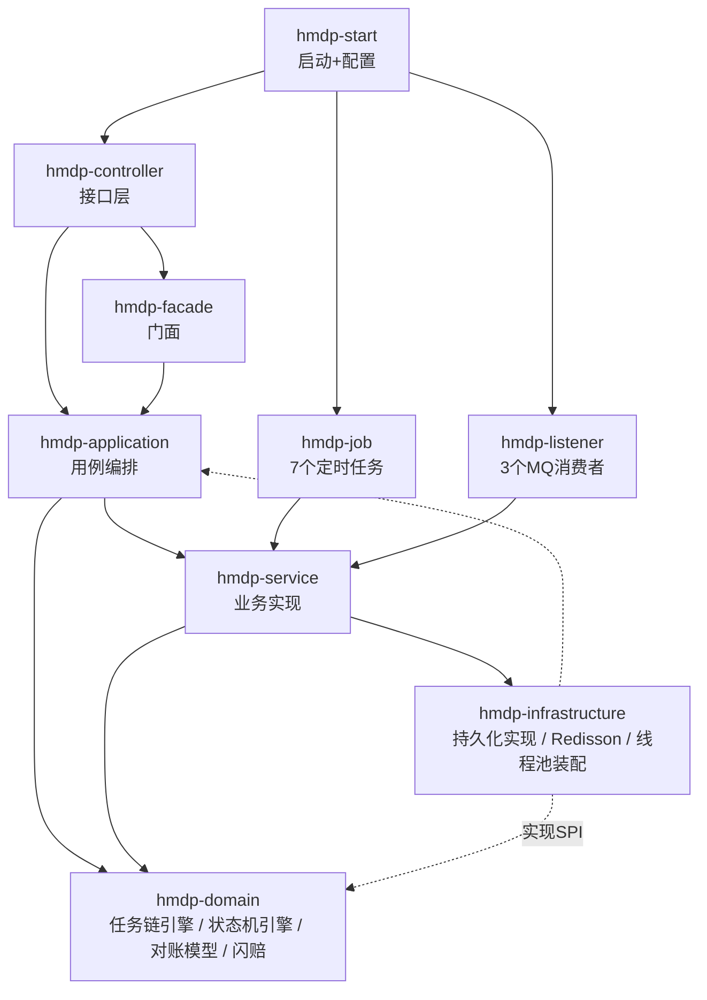
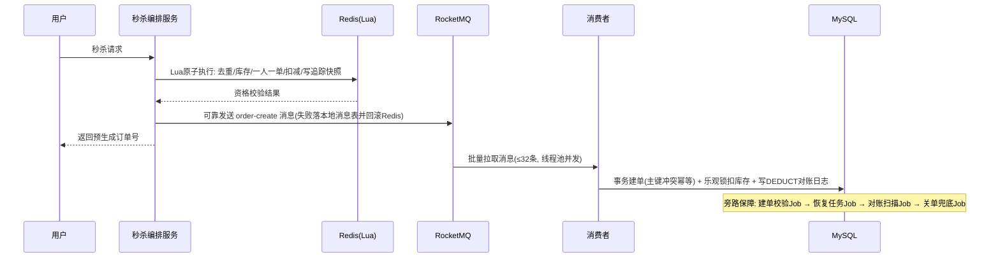

# 🐴 HeiMaDianPing — 黑马点评深度魔改版


一个基于**黑马点评**（大众点评类本地生活平台）的**深度魔改学习项目**。

原版项目解决了"从 0 到 1"——秒杀、缓存、签到、附近的人。本仓库聚焦"**从 1 到 10**"：当系统变复杂之后——

- **架构怎么升级**：单模块三层 MVC → 多模块 DDD 分层（9 个 Maven 模块，依赖从外向内）
- **代码怎么不失控**：自研可编排任务链引擎与 CBB 状态机引擎，把编排逻辑从业务逻辑中彻底剥离
- **数据一致性怎么保证**：Redis 预扣 + RocketMQ 异步建单 + 本地消息表 / 建单校验 / 恢复任务 / 对账补偿的四级可靠性兜底
- **线上问题怎么排查**：7 类 JVM 故障注入开关 + JMeter 压测 + Prometheus 指标 + Arthas 定位闭环

---

## ✨ 核心特性

### 🚀 秒杀 Plus — 全链路异步架构与一致性保障

- **Redis Lua 原子预扣**：请求去重、库存校验、一人一单、库存扣减、对账快照在单个 Lua 脚本内原子完成
- **RocketMQ 异步建单**：批量拉取（32 条）+ 自建线程池并发消费 + 手动确认，削峰填谷
- **消息可靠性治理**：同步发送 + 本地消息表兜底 + 定时重试；消费失败分级处理（MQ 重试 → 恢复任务重放 → 人工审核）
- **超时关单**：延时消息触发 + 定时兜底扫描双保险，关单幂等回补库存
- **对账体系**：DEDUCT / RESTORE 对账日志（含库存前后快照）+ 订单域与库存域双向扫描 + 异常工单分级处置

### 🧩 可编排任务链引擎（自研）

- **五阶段流水线**：PRE_VALIDATION → DATA_JUDGMENT → DATA_PROCESSING → DATA_INSERTION → POST_PROCESSING，各阶段独立配置串行/并行
- **注解驱动**：`@TaskNode` 声明归属/顺序/线程池类型/可跳过语义，启动期构建不可变执行计划
- **CPU / IO 双线程池物理隔离**，避免互相饥饿
- **copy-merge 上下文并发模型**（参考 MVCC 多版本思想），解决并行节点写入竞争
- **落地场景**：商详页多数据源并行聚合、店铺评分刷新流水线

### ⚙️ CBB 通用自动化执行流水（状态机引擎，自研）

- **双层抽象**：引擎层零业务感知（payload 纯字符串），业务层只实现 StateNode
- **断点续传式持久化**：StateTask + StateTransitionLog 全部落库（SPI 扩展点，内存实现 / MyBatis 实现可切换）
- **失败策略分层**：FailurePolicy（业务层：该不该重试）+ RetryPolicy（引擎层：还剩几次），不可重试自动转人工
- **落地场景**：无忧闪赔赔付流程（SUBMITTED → APPROVED → COMPLETED / MANUAL_REVIEW）

### 🧪 故障演练与压测闭环

- 7 类 JVM 故障注入开关：CPU 自旋、正则灾难性回溯、堆内存泄漏、ThreadLocal 泄漏、死锁、线程爆炸、大对象分配
- JMeter 压测脚本 + 结果归档 + Arthas 排查演练（dashboard / thread / jad / watch）

---

## 🏗️ 项目架构



> domain 层不依赖任何外层模块，是整个项目可复用的核心；infrastructure 反向实现 domain 定义的 SPI 接口（依赖倒置）。

### 秒杀主链路



---

## 🧱 技术栈

| 层次 | 技术 |
|---|---|
| 框架 | Spring Boot、Spring MVC、Spring AOP/事务 |
| 数据访问 | MyBatis-Plus、MySQL 8 |
| 缓存 | Redis（Lettuce 连接池）、Redisson |
| 消息队列 | RocketMQ（同步发送、延时消息、批量消费） |
| 文档/工具 | Lombok、Hutool、Spring Boot Actuator + Prometheus |
| 质量 | JMeter 压测、Arthas 诊断、JUnit |

---

## 📂 项目结构

```
dianping
├── hmdp-start           # 启动模块 + 配置
├── hmdp-controller      # 接口层：Controller、拦截器、故障演练接口
├── hmdp-service         # 业务实现：秒杀Plus、评分刷新、原版功能
├── hmdp-domain          # 领域层：任务链引擎、状态机引擎、对账模型、闪赔状态机
├── hmdp-application     # 用例编排：商详聚合、超时关单
├── hmdp-facade          # 门面：统一对外业务 API
├── hmdp-infrastructure  # 基础设施：持久化实现、Redisson、引擎装配
├── hmdp-job             # 定时任务：重试/校验/恢复/对账/关单兜底/同步
└── hmdp-listener        # MQ 消费者：建单/超时关单/评分刷新
```

---

## 🚀 快速开始

### 环境依赖

- JDK 8+、Maven 3.6+
- MySQL 8.x（库名 `dingping`，建表 SQL 见课程资料 `hmdp.sql`）
- Redis 5+（database 1）
- RocketMQ 4.9+（NameServer 默认 `127.0.0.1:9876`；本地无 MQ 时可启用 `MockRocketMQConfig` 的 Mock 生产者）

### 配置

`dianping/hmdp-start/src/main/resources/application.yaml` 支持环境变量覆盖：

| 变量 | 说明 | 默认值 |
|---|---|---|
| `DB_HOST` / `DB_PORT` / `DB_NAME` | MySQL 地址 | localhost / 3306 / dingping |
| `DB_USER` / `DB_PASSWORD` | 数据库账号 | root / 必填 |
| `REDIS_HOST` / `REDIS_PORT` / `REDIS_PASSWORD` | Redis 连接 | localhost / 6379 / 空 |
| `ROCKETMQ_NAMESRV` | NameServer 地址 | 127.0.0.1:9876 |

### 启动与验证

```bash
mvn -f dianping/pom.xml clean package -DskipTests
java -jar dianping/hmdp-start/target/*.jar
# 健康检查
curl http://localhost:8081/actuator/health
```

---

## 🔧 可观测与压测

- 指标端点：`GET /actuator/prometheus`（已暴露 health / info / prometheus）
- 故障注入：`POST /jvm/seckill-bug/{bug}/on|off`（7 类开关，`GET /jvm/seckill-bug/status` 查看状态）
- JVM 演练接口：`/jvm/cpu-loop`、`/jvm/deadlock`、`/jvm/full-gc` 等
- 压测：`stress-test/` 下提供 JMeter 脚本、准备与执行脚本、指标报告生成脚本

---

## ⚖️ 设计取舍（Known Trade-offs）

本项目有意保留了一些**已被识别的取舍点**，用于展示工程决策过程：

1. **延时消息档位与关单门槛存在时序差**——延时级别 14（RocketMQ 默认约 10 分钟）早于 15 分钟关单门槛，实际关单由 2 分钟周期的兜底任务完成；正确做法是档位与门槛二选一对齐。
2. **批量消费不向 MQ 回抛异常**——批处理异常转由旁路校验任务与对账兜底，换取批处理吞吐；代价是 MQ 层自动重试语义弱化。
3. **对账自动补偿默认关闭**——先观察异常模式再人工开启，避免补偿逻辑本身放大故障。

---

## 🗺️ Roadmap

- [ ] 接入虚拟线程（任务链 IO 池与消费池）
- [ ] Agent 评估体系（回答准确率/工具调用成功率）
- [ ] 多实例部署下的定时任务分布式调度（当前单机 `@Scheduled`）
- [ ] 补充压测对比报告（同步确认窗口开/关的 TPS / RT 数据）

---

## 🙏 致谢与声明

- 原始项目：**黑马点评**——黑马程序员课程项目，感谢原项目提供的"从 0 到 1"基础
- 深度魔改设计思路与教学：感谢课程作者 Knox 的架构设计与讲解
- 本仓库仅用于**个人学习与技术研究**，不用于任何商业用途；数据与压测结果均为本地实验环境产物
